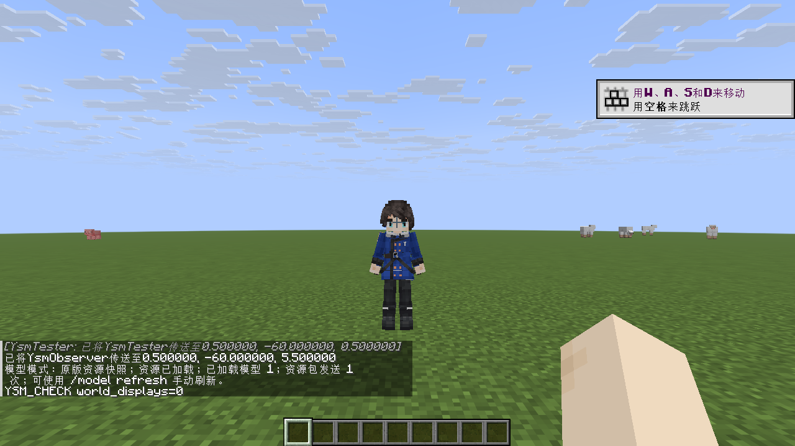
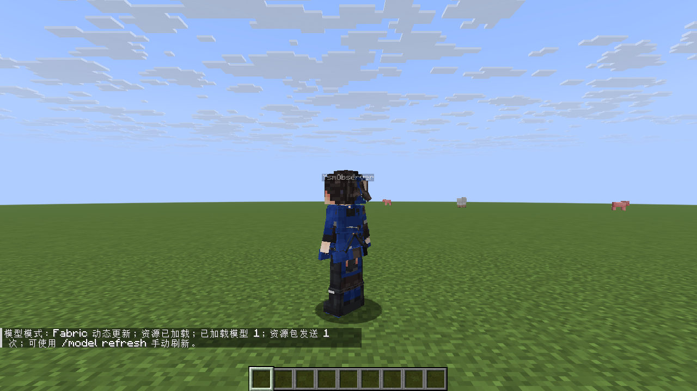
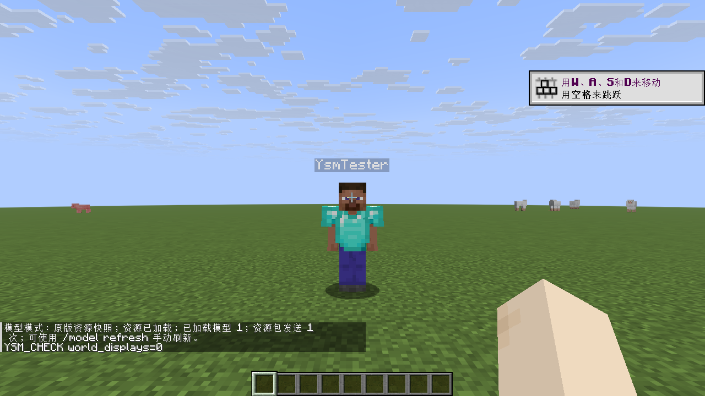
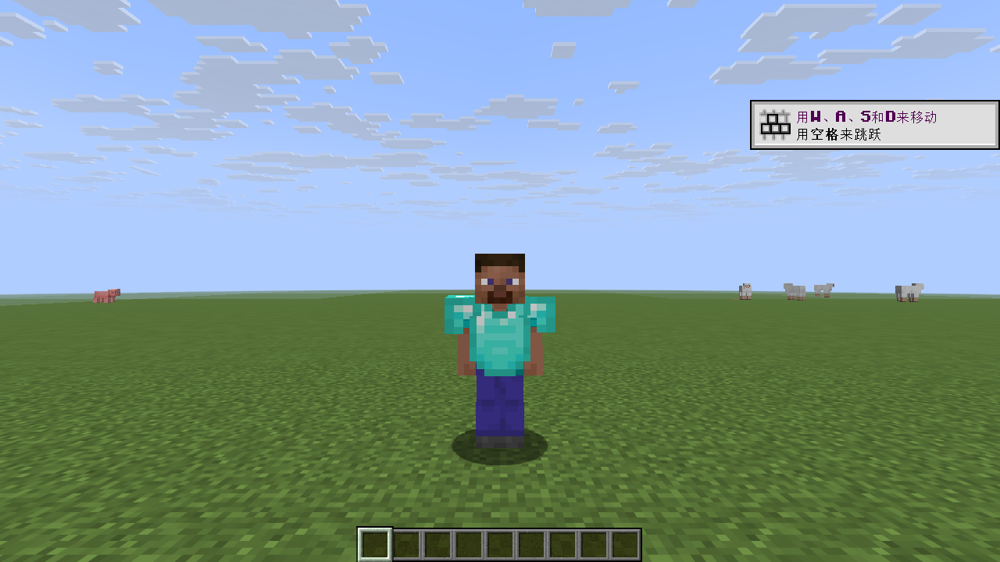
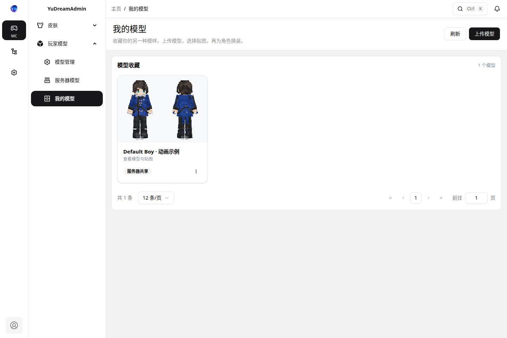
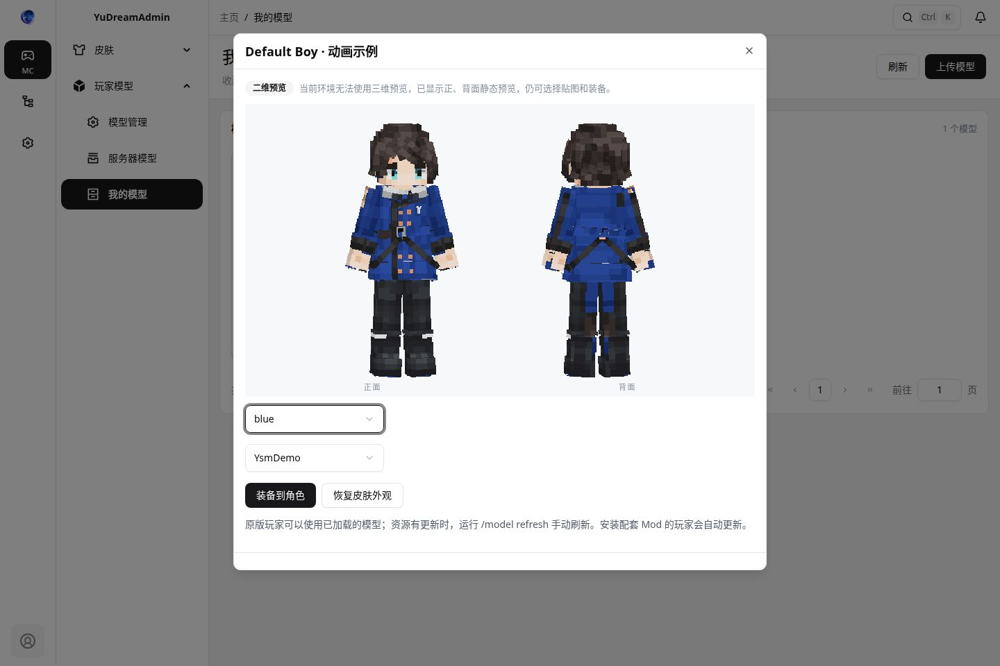

# 玩家模型验证记录

验证日期：2026-10-26。适配 Minecraft 26.3，网站数据使用通用 schema，不包含 Minecraft 版本或资源包格式号。前半部分记录网站 0.2.0 / 运行端 0.1.0 的历史验证；当前网站 0.4.1 / 运行端 0.2.0 使用 schema 2，补测见末尾。

## 构建与仓库检查

| 检查 | 结果 |
| --- | --- |
| 前端 `test` | 5 项通过；覆盖 pre/post、linear / step / Catmull-Rom、循环、镜像小数 UV、方块旋转，以及二维封面的父骨骼旋转、正背面取景、透明贴图叠层 |
| 前端 `vue-tsc` 与生产构建 | 通过 |
| Maven `test package` | 15 项通过：转换与客户端状态机 9 项、网站业务 6 项 |
| Gradle `:core:test :server-folia:jar :fabric-26_3:jar` | 通过；其中 core 为同一组 9 项测试，不重复累计 |
| 最终网站 JAR | remoteEntry、manifest、CSS、第三方 LICENSE / NOTICE 齐全，并与最终 dist 逐字节一致；未打入宿主 SPI |
| 仓库独立性、Maven 依赖边界、插件依赖无环、开发规范、发布流水线、文档独立性 | 检查通过；UI 审计没有新增问题 |
| 已发布 Maven SPI 解析 | 通过，版本 `2.38.0` |
| 完整 readiness | **未完成**：已发布 npm 契约重装时，默认镜像连接重置；改用 npm 官方源后仍有依赖包下载超时，脚本返回失败；不能据此声明整套 readiness 通过 |

## Minecraft 本地 MCP 实测

环境为独立 Folia 26.3 测试服、Java 25，两个真实 Minecraft 客户端通过本地 MinecraftMcp 操作和截图：

- `YsmTester`：安装本工程 Fabric 客户端、Fabric API 和 MinecraftMcp。
- `YsmObserver`：安装 Fabric API 和 MinecraftMcp，**没有安装本工程客户端**，用于验证原版资源包与虚拟展示实体路径。
- 新工程这轮未再启动完全不含 Fabric / Mod 的官方客户端；不能把观察者等同于完全无 Mod 客户端验收。旧原型的无 Mod 测试属于其他工程，不计入这里。
- 游戏实测的网站 HTTP 使用 mock bridge，模型 bundle 来自实际 `ModelCompiler`。后续真实 YDA 宿主补测见下节；尚未把游戏端改接真实宿主重新完成端到端实测。

| 场景 | 实测结果 |
| --- | --- |
| 初次进服 | 两端各发送 1 次资源包；Fabric 客户端显示实体 0，原版显示路径看到 37 个虚拟部件 |
| 服务器实体数量 | 验证辅助插件读取服务器世界，真实 ItemDisplay 数量为 0 |
| Fabric 下载新版本失败 | 保留旧外观；全局资源重载增加 0 |
| Fabric 更新模型 | 新 SHA-256 激活；全局资源重载增加 0；原版观察者继续旧快照 |
| 原版 `/model refresh` | 仅请求者资源包发送次数从 1 变 2；Fabric 保持 1；观察者发生 2 次全局资源重载 |
| 相同版本再次刷新 | 不重复发送资源包 |
| 恢复皮肤 | 原版虚拟实体清零，Fabric 清除模型 |
| 跨 Folia 区域 | 相距 2048 格时解除显示，重新靠近后恢复 37 个部件 |
| 跨维度 | 下界解除并重新建立模型显示，返回主世界后正常 |
| 最终 JAR 停用补测 | 两端清除模型；Fabric 收到 `YSM_RESET`；观察者和 Fabric 第三人称均恢复默认皮肤与已穿戴钻石胸甲；插件错误为 0 |

手动刷新出现两次重载，是因为先添加新包，新包加载成功后再移除本插件旧包，以保留下载失败时的旧资源。使用 `addResourcePack`，不会通过替换全部资源包移除其他插件的包。Fabric 后续更新只注册 / 释放模型局部纹理。

当前样例为 CC0 Default Boy 的数值动画副本，明确移除了 `parallel0` / `parallel1` 两条 Molang 动画。样例有 58 个骨骼、37 个可显示部件、156 个方块。此测试不能证明支持原始样例的全部 YSM 功能；Molang、加密 `.ysm`、逐面 UV、脚本和第一人称自定义手臂仍不支持。

精简机器结果和最终产物 SHA-256 见 [verification/summary.json](verification/summary.json)。原始 MCP 调用记录、完整结果和日志保存在本地 `/home/yudream/code/plugins/ysm-verification/runtime/evidence/`，未把运行配置或密钥加入仓库。

### 截图

原版显示路径，真实角色已经穿戴胸甲，模型显示时隐藏原版身体与装备：

Fabric 热更新后的第三人称模型：

最终 JAR 停用后，原版观察者看到恢复的皮肤与胸甲：

Fabric 收到 reset 后的第三人称恢复：

## 网页预览验收限制

已复用 [YSM Model Manager](https://github.com/eghrhegpe/ysm-model-manager) 提交 `d74f850ff3f1ca30af20195ecb77a5f7785f770e` 的网格、四元数和动画采样算法，并随产物分发 Apache-2.0 许可与来源说明。

内置浏览器已加载本地预览页、模型与源码，但 Mesa / ANGLE 在创建 WebGL 上下文时返回 `BindToCurrentSequence failed`。代码已增加中文失败提示；数学测试、类型检查和构建通过。**网页三维画面尚未成功验收**，也没有把游戏截图作为网页预览通过的证据。

## 真实 YDA 本地补测（网站插件 0.2.0）

- 独立演示数据库只启用皮肤插件和玩家模型附属，已完成示例模型上传、转换、角色装备和服务器共享；bridge 返回的资源哈希匹配，未授权访问返回 403。
- 我的模型、服务器模型使用正背面二维封面卡片；管理列表显示缩略图，名称列为封面保留空间，已检查 1440px 桌面表格与 390px 窄屏卡片。二维渲染不依赖 WebGL，详情页在三维初始化失败后显示二维预览与装备控件。
- 封面在 Worker 内按需生成，列表最多同时加载两个模型，并在页面退出时清理 Worker 与缓存。
- 已检查立方体入口和衣柜、模型库、设置子菜单。宿主会保留已持久化菜单的图标；本次演示通过菜单管理接口更新四个图标。新安装使用插件声明的默认图标。
- 二维静态画面已通过浏览器截图核验；三维 WebGL、跨贴图切换（当前示例仅一个贴图）与最终游戏端接真实宿主仍未完成验收。

菜单图标与封面：

二维详情：

## 后续验收范围

- 在可用 WebGL 的浏览器完成三维预览，在真实宿主完成跨贴图切换、管理员停用 / 删除，并将游戏端接入真实宿主复测。
- 完成已发布 npm 契约重装和整套 readiness。
- 使用最终运行端测试完全无 Mod 的官方客户端、其他资源包叠加，以及生产规模 TPS / FPS。

以上构建和功能结果不代表上述未验收项目已经通过。

## 0.3.0 / runtime 0.2.0 原始 YSM 修复（2026-10-26）

- 使用用户提供的本地私有 `.ysm` 验证：原始 1,343,953 字节 → 27 个文件 → schema 2，323 骨骼、235 部件、1759 方块、61 动画、1 张主贴图。样本和解码结果未纳入仓库或分发包。
- Java WASM 解码、编译、下载边界验证和全部动作采样通过；Java / Web 表达式与逐面 UV 回归通过，CPU 正背面封面实际渲染检查通过。
- 样本含 3 个负尺寸方块及一条 `-*ysm.second_order(...)` 畸形表达式，转换输出记录具体兼容说明。未宣称完整 YSM 物理 / 控制器兼容。

- 本地 YDA 页面真实上传原始 `.ysm` 成功，私有模型入库、旧 schema 1 封面回读、角色装备、带凭据状态查询及限时签名下载通过，下载 SHA-256 与入库 hash 一致。
- 当前内嵌浏览器无法启用 WebGL，已验收二维预览回退；本样本的游戏端实际画面与完整控制器 / 物理效果未验收。原始文件、截图和解码数据仅留本地，不作为 Release 附件。
- 本机 readiness 的结构、依赖边界、UI 契约和发布链检查通过；npm 契约重装步骤超过 10 分钟无进展后终止，不能记为整套 readiness 成功。正式发布以 CI 的对应 gate 为准。

## 0.4.0 上传设置与审核（2026-10-26）

此节记录历史版本行为；0.4.1 按下节权限规则修正关闭上传的语义。

- 前端类型检查、生产构建和 7 项预览回归通过；网站 Maven 16 项测试全部通过（含本地私有原始 YSM 样本），core 15 项及依赖 provider 测试通过。最终网站 JAR 的前端资源与 dist 逐字节一致。
- 策略存储、旧模型默认通过、关闭上传同时拒绝新建 / 新版本、转换过程中关闭上传阻止最终保存、审核原因、版本变化拒绝旧审核、筛选与拥有者隔离均有测试覆盖。
- 本地 YDA 管理页实际点击上传开关并自动保存；回读设置与直接调用上传接口验证禁用生效，未登录管理接口拒绝访问。用户页上传按钮禁用，待审核模型可预览、装备按钮禁用。
- 实际创建独立的测试模型，验证驳回原因、更新后重新待审、待审模型不进入共享库 / manifest，且有效签名也无法下载。管理页筛选待审核并点击审核通过成功，通过后可共享。测试记录已移除，上传策略恢复验证前值。
- 原始私有 YSM 在升级后仍为本人模型、保持原装备关系，宽高缩放为 0.6，签名下载 SHA-256 匹配。用户模型和截图没有加入源码或发布附件。
- 本机 readiness 的结构、依赖、UI 契约与发布链检查通过；npm 契约重装无进展，整套 readiness 未完成。对应远端门禁以发布 CI 结果为准。
- 本次没有新增真实游戏画面验收；网页三维仍受本地 WebGL 环境限制。既有游戏验证范围和其他限制沿用上文。

## 0.4.1 关闭上传时按权限放行（2026-10-26）

- 新增受限上传权限 `plugin:ysm-models:upload`；关闭上传时，明确持有此节点或超管 `*` 的账号仍可上传自己的新模型和新版本。仅有管理 / 配置权限不获得此豁免，审核策略继续生效。
- 网站 Maven 18 项测试、core 15 项及 provider 测试通过，私有原始 YSM 样本参与验证，无跳过。前端 7 项测试、类型检查与生产构建通过，最终本地 JAR 的 7 个前端资源逐字节匹配，解析器 SHA-256 正确。
- 测试覆盖伪造请求权限字段无效、可信 principal 授权、本人归属、新版本、禁止操作他人模型及关闭上传仍可装备已通过模型。
- 在本地 YDA 创建独立测试账号，实际登录验证普通账号的新建 / 新版本被拒，单独的管理与配置权限不能豁免；授予上传节点后两种上传成功，均待审核且归本人；撤销权限后再次被拒。超管通配权限上传成功。测试模型及账号已删除，测试角色已停用。
- 设置页面显示正确权限节点；关闭上传时，超管用户页提示仍可提交，上传按钮可用且能打开上传对话框。原始私有模型保留。验证后恢复原上传设置。
- 本机 readiness 已运行，结构、依赖边界、UI 与发布链检查通过；npm 契约重装在限定时间内无进展，未宣称全套本机 readiness 通过。正式发布仍核对远端 CI 门禁。
- 本版没有修改游戏运行端，继续使用已经构建验证、内部元数据正确的 Folia / Fabric 0.2.0；真实游戏及 WebGL 的未验收范围沿用上文。
